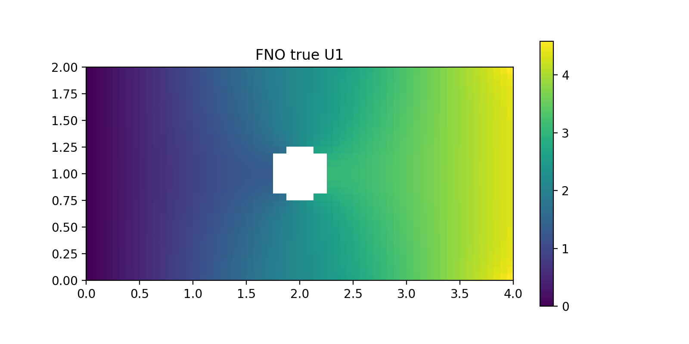
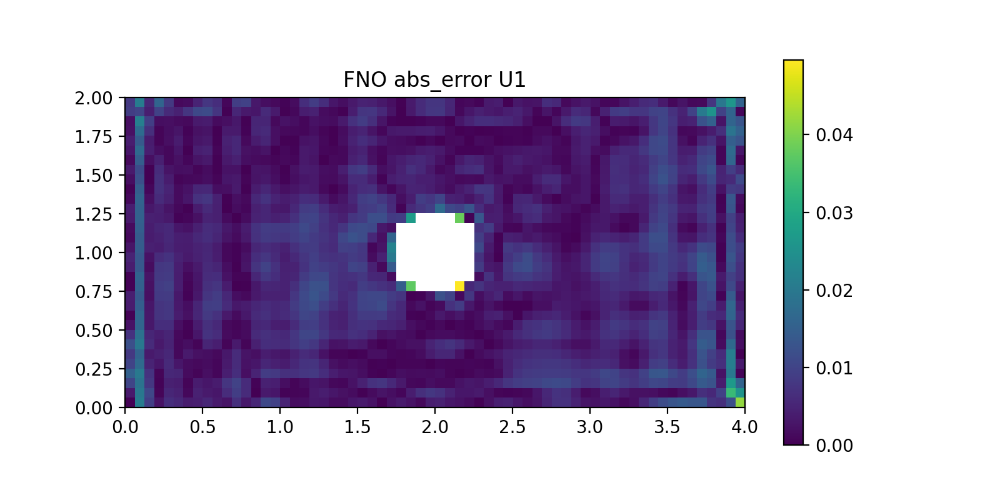

# Scientific Machine Learning for Parametric Elasticity: FEM, PINN, FNO and PINO

This project studies a parameterized 2D plane-stress elasticity problem: a finite rectangular plate with a circular hole under unit horizontal traction.

The main question is:

> Can neural operators provide fast full-field predictions for parameterized elasticity problems while retaining physical consistency?

## Problem definition

- Plate: `4 x 2`
- Hole center: `(2, 1)`
- Hole radius: `R in [0.20, 0.35]`
- Young's modulus: `E = 1`
- Poisson's ratio: `nu = 0.3`
- Plane stress
- Thickness: `1`
- Right boundary traction: `(1, 0)`
- Left boundary: `U1 = 0`
- Lower-left anchor: `U2 = 0`

For operator learning, the inputs are `X`, `Y`, the geometry mask, and `R`; the outputs are the displacement fields `U1` and `U2`.

## Workflow

1. Independent Abaqus reference check at `R = 0.25`
2. Python FEM solver and 51-case parametric dataset generation
3. Strong-form PINN baselines
4. Fourier Neural Operator (FNO)
5. Physics-Informed Neural Operator (PINO)

## FEM validation

At `R = 0.25`:

- Abaqus: `max U1 = 4.335395`
- Abaqus: `max S11 = 3.046240`
- Python FEM: `max U1 = 4.510764`
- Python FEM displacement error vs Abaqus: `4.05%`

The Python FEM stress peak is not used as a strict Abaqus validation metric because the implementations use different element formulations and stress post-processing.

## Neural-operator results

| Model | Mean U1 Error | Mean U2 Error | Internal PDE Residual |
|---|---:|---:|---:|
| FNO | 0.275% | 0.528% | 3.2821 |
| PINO | 0.662% | 1.189% | 0.0648 |

Additional FNO test results:

- Worst U1 error: `0.409%`
- Worst U2 error: `0.624%`
- Unseen test radii: `0.215, 0.245, 0.275, 0.305, 0.335`

PINO reduced the internal equilibrium residual by approximately **50.6x** compared with FNO, while FNO achieved higher displacement prediction accuracy.

Under the tested training configurations, the PINN baselines showed optimization difficulties in resolving the localized stress concentration. This is an empirical result for the tested setup, not a general claim that PINNs cannot solve such problems.

The PINO comparison focuses on the **internal equilibrium residual**. It does not claim complete satisfaction of the circular-hole traction boundary on the Cartesian operator-learning grid.

## Representative FNO result

| FEM-interpolated target | FNO prediction | Absolute error |
|---|---|---|
|  |  |  |

## Repository structure

```text
plate-hole-sciml/
├── fem/
│   ├── solve_plate_hole.py
│   └── generate_fno_dataset.py
├── fno/
│   ├── train_fno.py
│   ├── test_metrics.csv
│   └── training_history.csv
├── pino/
│   ├── train_pino.py
│   ├── test_metrics.csv
│   ├── training_history.csv
│   └── fno_vs_pino.csv
├── data/
│   ├── fno_dataset.npz
│   ├── dataset_summary.csv
│   ├── nodal_displacement.csv
│   └── stress_results.csv
├── results/
├── requirements.txt
└── LICENSE
```

## Reproduction

Install dependencies:

```bash
pip install -r requirements.txt
```

Run a single FEM case:

```bash
python fem/solve_plate_hole.py
```

Generate the 51-case dataset:

```bash
python fem/generate_fno_dataset.py
```

Train FNO:

```bash
python fno/train_fno.py
```

Train PINO after the FNO checkpoint has been created:

```bash
python pino/train_pino.py
```

Generated `.pt` checkpoints are intentionally excluded from version control.

## Notes

The dataset contains 51 FEM cases on a `32 x 64` Cartesian output grid. The parameter sweep varies only the hole radius. Abaqus is used as an independent validation reference rather than as the batch training-data generator.

## License

MIT License.
